# Website journey and polish log

Started 2026-11-15. Working branch: `codex/website-journey-polish`.

This is the shared record for Jay's step-by-step walkthrough. Keep observed behavior, desired behavior, and verification distinct. Update this document and [the improvement backlog](improvements.md) as each note is addressed.

## Starting the walkthrough

Open http://localhost:3001/signup?account_type=lookingForTalent in a fresh browser session. Use a new staging email, for example `jay+journey01@motiion.io`, so previous approvals and purchases do not skip steps. All staging Auth, application, team, and website notification emails are redirected to the single configured testing inbox. The email shows its intended account; enter its code while signed in as that account. The address on the account is not changed by delivery routing.

Keep `npm run dev` and the Stripe test webhook listener running. Use `4242 4242 4242 4242`, a future expiry, and any three-digit CVC. See [staging setup](../staging.md) for restart details. Production accounts and payment state are separate. Local credentials and test evidence live in ignored `.staging/` files and must never be committed.

For review, use a second browser session with the staging staff account at `/admin/industry-applications`. The staff login is in the private local login guide. Approving an application must not grant paid project capacity.

## Journey map

```mermaid
flowchart LR
    A[Home and pricing] --> B[Industry signup]
    B --> C[Verify email]
    C --> D[Complete application]
    D --> E[Await review]
    E --> F[Approved setup]
    E --> G[More information requested]
    G --> D
    F --> H[Choose project plan]
    H --> I[Stripe test checkout]
    I --> J[Verify paid capacity]
    J --> K[Create first project]
    K --> L[Invite project team]
    K --> M[Build and publish casting]
    M --> N[Receive and review submissions]
    N --> O[Finalize selected dancers]
    O --> P[Send and track confirmations]
    L --> Q[Verify invitee email and accept]
    Q --> M
```

## Step-by-step acceptance record

| ID | Step / entry point | What should happen | Engineering checks | Walkthrough state |
| --- | --- | --- | --- | --- |
| J01 | Home / pricing | Clear talent vs industry route, readable pricing, centered mobile logo and hamburger navigation | Responsive layout; image sizes; keyboard menu; layout stability; correct signup intent | Awaiting Jay's notes |
| J02 | `/signup?account_type=lookingForTalent` | Email/password and OAuth choices; actionable errors; no duplicate submission | Server validation; password-manager support; pending state; no sensitive values in URLs/logs; return-path retention | Awaiting Jay's notes |
| J03 | `/signup/check-email` | Verification email/code arrives; correct account verifies; continue to application | Expiry, wrong code, resend cooldown, duplicate click, network retry; preserve invite intent; no auth session before verification | Awaiting Jay's notes |
| J04 | `/talent-buyers/application` | Identity, work, projects, referral and review steps; preserve unfinished work | Validation ownership; refresh/back navigation; accessible focus; draft scoped to user; submit concurrency | Awaiting Jay's notes |
| J05 | Submitted / pending | Clear review status and receipt email; refresh button shows spinner | Atomic application save + queued receipt; no access escalation; retry/duplicate delivery; stale status refresh | Awaiting Jay's notes |
| J06 | Staff review | Request details or approve; correct email follows the current decision | Staff-only authorization; version conflict handling; stale notifications skipped; no self-approval | Awaiting Jay's notes |
| J07 | `/industry/approved` | Finish setup; Enter Motiion spinner; clear next action | One-time/idempotent setup; username race; durable approval; preserved return destination | Awaiting Jay's notes |
| J08 | First project / plan choice | Explain payment before creation; compare Project Pass, Studio, Production House | UI and DB agree on capacity; approved-but-unpaid account blocked even with direct RPC; owner pays for teammates | Awaiting Jay's notes |
| J09 | Checkout / return | Test payment returns to the right account; ready or honest confirmation-pending state | Verify Stripe server-side; signed webhooks; retries and out-of-order events; cancellation/decline; no duplicate purchases; test/live separation | Awaiting Jay's notes |
| J10 | `/projects` / New project | Successful first project appears once, with a useful empty state | Idempotent create; paid capacity consumed atomically; draft persistence; list invalidation; permissions | Awaiting Jay's notes |
| J11 | Team invitations | Email invitation, job title, admin default with editable access; new user verifies and accepts | Email-bound acceptance; expiration/revoke/replay; seats including pending invites; only owner changes access; coordinator restrictions | Awaiting Jay's notes |
| J12 | Casting setup | Clear role requirements, dates, publication state and share path | Schema validation; date/timezone consistency; autosave vs publish distinction; draft/privacy enforcement | Awaiting Jay's notes |
| J13 | Talent application | Talent sees appropriate role, submits once, gets useful status | Auth/consent, profile snapshot, upload limits and retry, deadlines, duplicate and cross-account checks | Awaiting Jay's notes |
| J14 | Review / shortlist / select | Names, headshots and recorded gender remain consistent across list and detail | Pagination/filter correctness; image loading; batch reads; stale state; no unrelated private profile access | Awaiting Jay's notes |
| J15 | Finalize selections | Exact selected dancers enter project People; safe retry | Atomic finalization; stale selection conflict; authorization; no unintended additions or duplicate participants | Awaiting Jay's notes |
| J16 | Confirmations and schedule | Correct dancer receives correct terms/dates; response and organizer state agree | Explicit handoff; talent identity binding; state transitions; retries; coordinator cannot change contracts/rates/casting decisions | Awaiting Jay's notes |

## Per-step working method

1. Capture the exact screen, actor, data state and note. Reproduce once before changing code.
2. Trace the interaction through UI → server action/API → authorization/database → external service → updated UI. Identify the authoritative state and who may change it.
3. Check initial loading, pending action, success, empty state, validation failure, network failure and retry. Use a spinner for an action and a stable skeleton for content where appropriate; preserve accessible labels and focus.
4. Check data access: no repeated auth/profile fetches within the request, no accidental serial work, bounded reads, appropriate invalidation, no cross-user cache reuse, and minimal privileged access. Measure before adding caches.
5. Check correctness under duplicate taps, refresh/back navigation and interrupted connections. Add focused regression tests for permissions, money and durable state; avoid tests that merely restate cosmetic implementation.
6. Verify the changed path on desktop and mobile, record the outcome, and keep unrelated improvements in the backlog. Use production builds for performance conclusions; development compile times are not production latency.

## Notes log

| Date | Step | User note / evidence | Agreed change | Validation | Status |
| --- | --- | --- | --- | --- | --- |
| 2026-11-15 | Setup | Jay wants realistic staging data, inbox-only test mail, and an engineering review alongside every UX step | Staging data and email isolation; journey map; prioritized backlog | See staging verification record | Ready; walkthrough starts at J01/J02 |

For new notes, use a short identifier such as `J03-N01`. Record actual results here, and link larger follow-ups to the backlog rather than silently expanding the current step.

## Baseline already verified before the walkthrough

- Website release `d46e0c2` synced to main; polish work continues on a separate branch.
- Local Supabase ref is `mvkvztpvakybrhyupown`; both local-production escape flags are off.
- 24 separate staging talent accounts, 36 copied headshots, 3 fictional projects; names and recorded gender preserve their source pairing.
- Stripe test subscription events returned HTTP 200 locally and granted staging project capacity.
- Approved unpaid account was rejected by project creation; a paid producer created three projects.
- Two selected dancers finalized atomically into sample project People.
- Authenticated local project list, talent search and project overview returned HTTP 200. This is a smoke check, not completion of the visual walkthrough.

## Staging email verification — 2026-11-15

- A real staging signup invoked the signed Auth hook; Auth returned an unverified account with no session. Jay confirmed the signup email arrived in the configured inbox.
- A separate pre-verified backend fixture submitted an application; the receipt queue was acknowledged `sent`. A staging staff account approved it, and the approval email was acknowledged `sent`.
- The sample producer sent a project admin invitation. Its queue was acknowledged `sent`; the intended verified account accepted through the website's public `join_featured_workspace` RPC and received project admin access.
- Both scheduled delivery jobs are active and their latest executions succeeded. The worker endpoints reject unauthenticated requests.
- Application and team `sent` states mean provider acceptance. Their inbox delivery was not independently read; the Resend key is send-only. No code was taken from the user's inbox, and this automated fixture check does not replace the fresh-user UI walkthrough.
- 41 focused environment, verification and mail-handler tests passed, plus website TypeScript checking. Run `npm run test:staging-email` for the mail regression suite.

Current walkthrough checkpoint: J01/J02. All visual steps remain open for Jay's notes.

## J02 — initial signup screen review, 2026-11-15

Observed the existing industry signup screen in Jay's Dia browser without navigating or entering data. The email field was empty and Continue with Email was disabled; Google and Apple options and the staging banner were visible. No loading latency was measured from this already-loaded screen.

- J02-N01 (UX recommendation): The generic “Sign up for Motiion” heading does not identify the industry/hiring path until the subtitle. Consider a clearer hiring-specific heading. Await Jay's preference.
- J02-N02 (observed copy): “Already have an account? Log in or Sign up as talent” combines an existing-account action with a new-account alternative. Separate these meanings in the layout/copy.
- J02-N03 (UX recommendation): “Access requires an application” explains review, but does not distinguish free application from payment before project creation. Consider concise expectation-setting; confirm the amount of detail appropriate on signup with Jay.
- J02-N04 (code observation; interaction check pending): Continue with Email changes the URL via router.push; the spinner's loading state is set only during actual account creation. Observe transition responsiveness and focus on the password screen before deciding whether state or navigation needs changing.
- J02-N05 (architecture investigation): Signup awaits getCurrentUserProfile before returning its shell; SignupForm has a null Suspense fallback. Measure initial/return navigation before attributing latency to this design. Session-dependent redirect behavior must be preserved.

Current checkpoint: collect first-screen notes, then enter a fresh test email and advance only to the password step. No account was created during this inspection; UI and application code remain unchanged.

### J02 — first-screen refinements

Jay rejected hiring-focused language as too transactional for creative directors and requested stronger spacing hierarchy. Chosen heading: “Create your industry account”; reserve workspace language for the project experience.

- Implemented J02-N01–N03: industry-specific heading and creative-focused subtitle; concise free-application/payment-before-project explanation; separate login and talent routes below the form.
- Tightened the introduction and distinguished form, legal copy, and secondary navigation with scoped spacing. Signup-only styles preserve other auth screens.
- Implemented pending feedback for J02-N04 using the router transition state: spinner, disabled submission/OAuth controls, and stable accessible button name. Actual transition timing and focus behavior remain to be checked with the next walkthrough step.
- Verified the revised desktop layout in Dia on localhost. TypeScript and targeted ESLint passed. Mobile visual verification remains open. J02-N05 remains an investigation; no initial-loading performance claim is made.

Current checkpoint: review the revised signup screen with Jay, then advance to the password step using a fresh test email. No account was created or submitted during this refinement.

### J02 — concise copy and password alignment

Jay requested removing repeated landing-page messaging, a single-line desktop payment explanation, and centered password context. Removed the promotional subtitle and replaced the note with “Apply for free; payment is required before creating a project.” Removed its narrow text constraint while retaining natural mobile wrapping. Centered the password context and allowed long email addresses to wrap. Visually confirmed the one-line note and centered password context in Dia at the current desktop viewport. TypeScript and targeted ESLint passed. Presentation-only changes add no queries or loading work and leave signup, authorization, errors, and payment enforcement unchanged. No form was submitted.

### J02 — one changing guidance line

Softened industry intro to “Apply for free, then choose a plan when you’re ready to create a project.” The password step replaces that intro with “Create your password for [email]” in the same centered position. The form owns both the step state and guidance, avoiding duplicate email state or additional queries. Existing talent and invitation intro copy remains on their email steps. Verified the password layout in Dia; TypeScript and targeted ESLint passed. No account submission or backend change.

### J02 — password field tab order

Jay requested Tab skip password visibility buttons. Both signup visibility toggles now have tabIndex=-1, so sequential keyboard navigation moves directly between password inputs. The buttons retain click/tap behavior and accessible names, but are intentionally excluded from sequential Tab navigation. This presentation change does not alter auth, loading, validation, or database behavior.

### J02 — signup submission progress

Jay observed no spinner while submitting signup. The submit button now reads React useFormStatus from inside the form, in addition to the existing request and navigation flags. Both successful signup destinations now use a tracked navigation transition, closing the gap where finally cleared loading before the next route rendered. The button stays disabled and announces busy while pending; error exits still allow retry. TypeScript, targeted ESLint, and diff checks passed. Real submission/spinner timing remains to be verified during the next staging signup; no new account was submitted for this patch.

### J03 — simplify email verification

Jay requested a single instruction above the verification code. Replaced the form introduction with “Enter the code to continue creating your account.” Removed the industry “One more step” subtitle and device explanation. Kept verification, resend, change-email, login, and conditional error/account-recovery controls. Verified the revised industry screen in Dia; targeted ESLint and diff checks passed. Copy-only change leaves verification requests, authorization, cooldowns, and state unchanged. No code entered or submitted.

### J03 — verification spinner and shared spacing

Verify and Continue now uses ButtonProgress with an accessible busy state. Successful verification retains verifying=true throughout the full navigation; failed responses and exceptions clear it for retry. Full navigation still reads newly set session cookies. Industry verification now shares signup’s account-creation shell, logo, title/intro spacing, responsive form gap, and separated secondary links. Visually verified the desktop layout in Dia. TypeScript, targeted ESLint, and diff checks passed. Successful code submission and spinner timing remain for the live walkthrough; no verification code was entered for this change.

### J03 — code entry and email refinement

Implemented a single larger, centered, evenly spaced numeric code field with Enter code placeholder, explicit focus ring, existing one-time-code autofill, and numeric keyboard. Client and server normalize spaces and common dashes; letters and invalid lengths still fail validation. Tests cover pasted formatting, leading zeroes, malformed input, verification recovery, staging routing, and template synchronization. Signup email now makes the uninterrupted code primary with concise account-creation copy in HTML and plain text, removing the competing confirmation link.

Deployed staging-auth-email version 6 to mvkvztpvakybrhyupown only. Twelve focused verification/email tests, TypeScript, targeted ESLint, and diff checks passed. Saved staging configuration records eight digits and a 3600-second expiry, but live settings could not be reread through the local credential, so no exact expiry promise was added to the email. Dia is already on the industry application; the revised input and new email delivery remain for the next verification walkthrough. No account was created or code submitted during this change.

### J04 — industry identity step layout

Jay requested a distinct fade/rise entrance, a wider desktop layout, stronger hierarchy, improved birthday entry and Continue placement, and removal of distracting footer navigation. Added an application-specific 64rem shell with introduction beside the form on desktop and a single-column layout below 800px. Added a 380ms opacity/16px-rise entrance only when reduced motion is not requested. Replaced the visible native file-picker chrome with a focusable labeled upload action.

Birthday now uses labeled Month / Day / Year controls with autofill and numeric day/year keyboards. Partial drafts persist in existing date storage; complete dates normalize to ISO before validation so Enter works with a single-digit day. Existing impossible-date and 18+ checks remain. Continue is compact and right-aligned on desktop, full-width on mobile. Removed Back to Motiion (previously onboarding or talent home) and the page footer divider; sign-out remains available under Account options. No new queries or animation library. Existing account-scoped drafts, debounced username checks, upload locks, and server submission remain.

Verified desktop composition in Dia. TypeScript, targeted ESLint, diff checks and 13 total application/birthday tests passed, including segmented-date normalization. Entrance timing and mobile appearance still need walkthrough confirmation. No profile edits or application submission were performed through the browser.

Follow-up observation: the initial Name currently contains the email alias rather than a person’s name; review initial-name fallback before final polish.

### J04 — live one-page application preview

Added a persistent white paper-style preview to the right of the input column. It derives directly from the existing draft, including photo, identity, work, project types, and acquisition information, without additional network requests or duplicated draft state. Current sections highlight, completed sections retain their content, and upcoming sections show blurred placeholder lines rather than actual future values. Text fades in as answers change; reduced-motion settings disable this effect. Long values are visually bounded with the full value available in the title and editable form. The preview remains one document through the review step. Under 1000px it becomes an expandable preview below the form to preserve input space.

Desktop composition verified in Dia. TypeScript, targeted ESLint, and diff checks passed. Mobile disclosure and every populated step still need walkthrough review. No form values were entered or submitted during this visual refinement.

### J04 — consistent fields, action footer, and paper heading

Restored pill-shaped inputs and selects with the signup border, background, and focus treatment. Native selects retain keyboard semantics with a custom chevron inset 18px and 44px reserved right padding. Aligned the application and footer to the marketing header’s 1368px container/40px desktop gutters, with 20px mobile gutters. Continue/Back now live in a sticky bottom footer, draft status to the left; the external submit button references the existing form ID to preserve native required validation and Enter submission. Removed the paper masthead/eyebrow/subtitle, leaving Industry application with a circular avatar vertically centered beside it. Active preview sections use the cyan brand accent. Shifted the staging notice above content to avoid obscuring footer status.

Desktop layout reviewed in Dia. TypeScript, targeted ESLint and diff checks passed. No draft values were edited or application submitted by the agent. Mobile footer wrapping and step progression remain part of the walkthrough.

### J04 — paper dimensions and identity field balance

Locked the preview to US Letter 17:22 proportions, capped at 480px wide, with proportional typography and fixed paper geometry independent of changing content. It retains sticky desktop positioning. Removed the mobile preview/toggle; the step eyebrow now appears only at the single-column breakpoint (1000px and below). Username status is beside its label: green Available, red Unavailable/Check failed, neutral Checking; stale responses are not displayed for changed usernames. Added professional-name guidance and expanded the birthday group to the full input-column width with proportionate month/day/year controls. Explicit heading row sizing prevents paper height from inflating heading-to-form spacing. Desktop paper proportions, populated values, and green availability placement verified in Dia. TypeScript, targeted ESLint, and diff checks passed. No values entered or submitted by the agent.

### J04 — preview anchoring and final spacing

Matched username availability's right inset to the label's left inset and increased the introduction-to-form gap. Moved desktop Account options beneath the paper, aligned right, while retaining a separate mobile placement when the preview is hidden. The desktop preview now uses viewport-fixed positioning and vertical centering with viewport-bounded Letter proportions. Removed persistent transform containment from the application transition wrapper and changed the entrance animation fill so completed animation does not cause the fixed preview to scroll with its parent. These changes add no network requests or draft state.

Verified the populated first step in Dia: inputs, paper, Account options and Continue all fit the current desktop viewport; a scroll attempt left the composition unchanged. Longer overflowing steps and mobile remain for the walkthrough. TypeScript, targeted ESLint and diff checks passed. No form values changed or application submitted by the agent.

### J04 — quiet staging indicator and identity dividers

Replaced the application screen's staging chip with a small amber circle fixed bottom-left, retaining the full status text for assistive technology and a hover title. Added two subtle full-width separators: after the avatar and between name/username and birthday. Verified the desktop result in Dia, including the visible action footer and account options. Targeted ESLint and diff checks passed. Presentation-only changes do not alter loading, requests, validation, authorization or draft persistence; no account data was edited or submitted.

### J04 — balanced divider spacing

Removed the divider negative margins and extra avatar bottom padding; both divider boundaries now use a consistent 24px grid gap above and below. Visually verified in Dia with the full first step and footer visible. Diff check passed. CSS-only adjustment; form behavior and data flow unchanged.

### J04 — step motion and professional role selection

Added sequential 12px fade/rise exit and entrance for the application intro/form (140ms out, 220ms in), reversed for Back. A synchronous navigation guard and disabled actions prevent repeated transitions; reduced-motion preferences skip movement. Preview sections animate position, active highlighting, and the reveal of previously hidden fields while the paper stays fixed.

Your work now has a searchable multi-select disclosure with native checkboxes, keyboard Escape/blur dismissal, and custom Other input. Search Enter does not submit the application. Selections remain a semicolon-separated string in the existing role field, preserving existing single-role drafts and server validation. Added role guidance and renamed Company with guidance to enter Independent. Work groups have soft dividers; form divider opacity reduced to 4.5%. No additional requests or database changes.

TypeScript, targeted ESLint, diff checks and ten application tests passed, including acceptance of multiple/custom roles. In Dia, navigated from identity to work, verified the retained role, opened the picker and checked Escape dismissal. No field values changed or application submitted. Exact motion feel, selecting several roles, mobile and reduced-motion rendering remain for the user's walkthrough.

### J04 — picker feedback, broader roles and clearable text inputs

Role picker caret rotates on open/close, with reduced-motion support. Selected checkboxes are white, and option rows have subtle hover and keyboard-focus backgrounds. Added Director, Production Manager, Production Coordinator, Stylist / Wardrobe, Hair / Makeup, Photographer and Videographer; retained search and broad Choreographer classification rather than project-specific seniority variants.

Added a shared clearable input for the application's single-line free-form fields, day/year, custom role and role search. Populated fields show a filled circle-X button with a field-specific accessible name; clearing returns focus to the input and updates the existing draft state. Added Contact email guidance allowing personal addresses. No new requests or persistence changes.

TypeScript, targeted ESLint and diff checks passed. Verified in Dia: open caret, white selected checkboxes, role search matching Wardrobe, clear restoring the unfiltered list and input focus, and Escape dismissal. User-entered application values were preserved; only the transient search was changed during verification.

### J04 — dropdown entrance and stable role selection

Added a 180ms fade/6px rise with slight scale when the role menu opens; reduced motion disables it. Corrected a likely cause of intermittent selection dismissal: native label clicks can emit blur with a null relatedTarget before checkbox focus, so null blur no longer closes the disclosure. Outside pointer dismissal uses containment and a cleaned-up document listener; keyboard focus leaving the picker and Escape still close it.

Clear buttons now use focus-within visibility: only populated active fields expose the button; moving focus to the clear button keeps it available, while leaving the field hides it from view and keyboard navigation. In Dia, tested repeated role-label selections with the menu remaining open, restored original roles, and confirmed Company clear control appears on focus and disappears on blur. No application submission. TypeScript, targeted ESLint and diff checks passed. The original reported crash was not reproduced; the concrete premature-dismissal path was fixed.

### J04 — compact role menu and selection count

Capped the role viewport to four 44px options, with independent overflow scrolling and a small right-aligned live selected count below a subtle divider. Search and count remain outside the scrolling list. Added the existing data-lenis-prevent convention after browser verification exposed the page smooth-scroll handler intercepting nested scrolling. Verified first and last four options in Dia with the count remaining visible. Targeted lint and diff checks passed. No role values or application data changed.

### J04 — understated role search

Replaced the dropdown search pill with a transparent input, magnifying-glass icon and “Search for a role” placeholder above a faint underline. The underline strengthens on focus; existing search, clear control and accessible label remain. Verified appearance in Dia. Targeted lint and diff checks passed; presentation-only change with no data or selection changes.

### J04 — projects step consistency and qualification review

Reviewed the populated projects step in Dia. Renamed the heading Your projects with collaborative wording, grouped selection guidance beside the Project types label, matched chip backgrounds/borders to existing inputs, used 44px targets and stable checkmark space to prevent selection reflow. Preview now parses stored project selections into readable comma-separated text and uses full section width. Verified the updated desktop layout and all current selections preserved. TypeScript, targeted ESLint and diff checks passed. Existing validation and persisted data format unchanged.

Suggested optional qualification questions (not yet implemented): concurrent dancer projects, work frequency, and number of teammates managing projects (excluding dancers). Local pricing describes Studio as one concurrent project and Production House as five; frequency helps contextualize Project Pass versus subscription. Collaborator job titles are better captured in project invitations. Recommendations should remain editable suggestions, never approval criteria or automatic plan assignment.

### J04 — workload answers and analytics review (2026-11-15)

User requested all three qualification questions and visibility while reviewing applications in Analytics. Added optional pill radio groups for concurrent projects, frequency and management-team size, with Not sure and Clear answer. Shared descriptors keep applicant, paper preview, final review, Analytics → Reviews and account Professional context labels consistent. Existing drafts hydrate missing fields as blank; historical applications display Not provided.

Applied migration 20261115234946 to staging only. Nullable constrained columns and an authenticated-only submission wrapper save the answers atomically with the existing identity/version-checked application submission. Existing clients retain their original RPC. No extra per-selection requests, permission expansion, production migration or automatic plan assignment. Draft isolation and existing error/retry behavior are preserved.

Validation: 27 auth/application/admin tests passed, TypeScript and targeted ESLint passed. Staging transaction verified save, edit, blank and Not sure values, invalid-value rejection and stale-version conflicts, then rolled back all synthetic data. Verified applicant layout and fixed preview during scrolling in Dia, and all three labeled values in the read-only admin review fixture. Preserved user-entered values and did not submit their application. Mobile rendering and the user's eventual full submission remain part of the walkthrough.

### J04 — quieter project controls

User found the project step text-heavy and reported a thick outline after selecting radio chips. Replaced project-type chips with the same shared searchable multiselect used for professional roles: animated disclosure/caret, four-row scroll viewport, white checkboxes and selected count. Collapsed summaries show two choices plus the remaining count. Shortened workload legends and removed redundant helper text while retaining team-size clarification. Radio chips now show a subtle outer focus indicator only for keyboard navigation, not pointer selection.

Extracted ApplicationMultiPicker so dismissal, search and menu behavior stay consistent across both steps. Selection serialization, draft persistence and analytics answers are unchanged; no new requests. Verified current project selections, opening/Escape dismissal, compact layout and selected-chip pointer focus in Dia without changing answers. TypeScript, targeted ESLint, diff checks and 27 existing application/auth/admin tests passed.

### J04 — required workload questions

Follow-up: increased the space between the three question groups from 24px to 40px, keeping each question close to its answer choices. Chose spacing to improve grouping without adding visual dividers. Presentation-only change; checked the CSS diff.

User requested required answers, question-style input labels, and removal of the workload heading, explanatory text and Clear answer buttons. Implemented all three as required native radio groups with direct questions; the team question includes self and excludes cast. Not sure remains a valid answer. Shared validation blocks missing answers on project continuation and website server submission, while draft hydration continues accepting incomplete/older drafts so saved work is never discarded. Historical database records and older clients remain compatible.

Verified updated questions and removal of extra text/buttons in Dia without changing answers. TypeScript, targeted lint and 27 tests passed, including missing/null/undefined rejection at projects and review, Not sure acceptance, and incomplete draft recovery. Analytics fields and persistence are unchanged.

### J04 — consistent referral choices and long-form notes

User requested consistent selection controls on How did you find us and room for a longer answer. Reused the projects-step radio pill styles, including white selection and keyboard-only focus. Removed obsolete referral-card styling. Converted optional extra details to a five-row, vertically resizable textarea with matching surface/border and rounded corners, separated from choices by 40px. Preserved the existing 2,000-character limit, controlled draft state and submission field; source remains required and controls respect the busy state.

Verified in Dia with existing source and notes preserved. TypeScript, targeted lint and diff checks passed. No new requests or persistence changes. During visual review, noticed the populated paper preview's final section crowds its footer; recorded separately for layout follow-up.

### J04 — one-page preview footer clearance

User requested fixing the final preview section overlapping the footer without resizing the paper. Changed the sheet's internal layout to three grid rows (heading/content/footer), reduced heading and section padding, tightened row/heading gaps and defined line heights. Preserved paper aspect ratio, width, fixed position, body font size, animations and existing two/three-line truncation with full values in title attributes and the editable form.

Visually verified in Dia with all four populated sections and multiline additional notes: final section ends clearly above the footer and paper dimensions remain unchanged. No applicant values changed. CSS diff check passed; no data, request, or validation changes.

### J04 — footer alignment, readiness and expanded review

User requested Back at left, centered saved status with a faint filled check, required-field gating on Continue, and a large centered application for review. Footer now uses equal outer grid columns with an independent center status; narrow screens place status beneath the controls. Continue derives readiness from the same normalized step validation used by submission, plus username availability, custom-role completion and pending-operation guards. Submit events respect the same gate. Existing Company requirement remains. Empty optional portfolio/notes do not block progress. Upload/submission buttons show a spinner.

The same paper component expands into the centered review layout with a Motion layout transition (reduced-motion aware), title Review Your Application, complete answers, and keyboard focus at its title. Removed the duplicate review card. Review allows long answers to expand the sheet and page rather than truncate them; compact step previews retain fixed Letter dimensions. Mobile review shows the document with readable text and a single-column field layout. Back returns to editing; submission remains explicit.

Verified the centered desktop sheet, complete review fields and new footer in Dia, preserving all user answers and leaving the application unsubmitted. TypeScript/targeted lint passed; tests include per-step required fields and optional-field acceptance. Exact transition feel and mobile rendering remain part of the user's walkthrough.

### J04 — viewport-fit review and reliable return

User requested review fit above the footer without page scrolling, correct Back positioning, and concise progress/save status. Review now keeps the Letter ratio and scales against viewport height/width with reserved header/footer space. Restored compact value summaries (full text retained in hover titles and editable fields) instead of growing the document with long answers. CSS owns the aside's position/size transition; removed competing Motion layout transforms from the fixed aside. Reduced-motion skips that transition. Application pages disable marketing scroll inertia, and step changes reset page scroll and focus the heading without implicit scrolling. Footer reads Step N of 5 · All changes saved, retaining a distinct storage-failure message.

Verified forward navigation from Projects through review and Back to the connection form in Dia: entire review sheet fits above the footer, and the form/side preview return to their intended positions. Existing answers retained and no submission. TypeScript, targeted ESLint and diff checks passed. Small-screen visual review remains pending.

### J05 — real staging submission and receipt walkthrough

User authorized submitting the application and reviewing confirmation/email. Confirmed the submit button uses the pending transition for Submitting… plus LoaderCircle, disabling repeat clicks; added aria-busy. Submitted the user's current staging application once in Dia. Observed Application submitted followed by Application under review after the server refresh/remount. The automation returned after completion, so the transient spinner was verified in code rather than captured visually. Staging database confirms pending version 1 with all three workload answers; the submitted receipt queue shows sent on first attempt with no error. This means provider acceptance, not verified inbox delivery. Gmail connector returned Unknown tool; asked the user to confirm receipt in jay@motiion.io.

Confirmation findings: content inherits the wide application container, making the main status button excessively wide; status guidance repeats; transient receipt text changes quickly because the form's key includes application version/status. Suggested a constrained centered confirmation, one stable success/pending message and explicit email-next-step wording. Receipt template is currently plain text, confirms review/no action required, links to application status and distinguishes submission from approval/payment. Staging routing prefixes the subject and redirects to the configured test inbox; no new production changes.

### J05 — confirmation polish and inbox confirmation

Jay confirmed the staging receipt arrived, completing the submission-to-inbox walkthrough. On request, constrained the confirmation to 480px with a 280px primary action, smaller subtle status icon, consistent spacing and centered secondary/account controls. Consolidated copy to explain review and email next steps. Immediate receipt and persisted pending state now use identical title/body/icon, avoiding the visible message swap on server refresh. Refresh retains its text plus spinner and disabled/busy state. Feedback and correction actions remain available for other statuses. No additional submission or email was sent.

Verified updated desktop layout in Dia. TypeScript, targeted ESLint, ten application tests and diff checks passed. No database, authorization or delivery changes.

### J04/J05 — account options in header

Moved the single Account options disclosure to the far right of application header navigation after a subtle vertical divider, via an optional accountMenu slot on the shared auth shell/header. Removed copies from the preview, mobile form and status screen. On mobile it belongs to the hamburger menu after a horizontal separator, preserving the centered logo. Header navigation only dismisses for links so account disclosure clicks do not collapse the mobile menu. Added outside-pointer, keyboard-focus-leave and Escape dismissal with focus return; existing sign-out pending/error handling remains.

Verified desktop placement, open menu and Escape dismissal in Dia without signing out or modifying application data. TypeScript, targeted ESLint and diff checks passed. No additional requests; other marketing pages omit the optional slot.

### J04/J05 — account profile menu

Renamed the header disclosure to Account. Its menu now begins with a circular avatar and applicant name, with first/last initials when no picture exists, followed by a subtle divider and the existing different-account prompt and Sign out action. Uses existing application state without additional requests. Verified the avatar, name, divider and copy visually in Dia; initials fallback reviewed in code. TypeScript, targeted ESLint and diff checks passed. No sign-out or data changes.

### J04/J05 — simpler sign-out action

Removed the different-account prompt from the Account dropdown and changed Sign out text to red. Preserved the profile row, subtle divider, pending/disabled state and error feedback. Presentation-only change; no request or authorization changes.

### J06 — staging approval for onboarding walkthrough

Approved the current test application (version 1) through review_industry_application using the existing staging test staff identity. Verified approved status and exactly one approval review record. Approval email was queued with no error; inbox delivery has not yet been verified. Applicant remains on the review screen so Jay can tap Check application status and experience the transition to onboarding. No paid entitlement was added, and production was untouched.

### J06 — visual approval welcome

Replaced the repeated approval message and icon list with a personalized welcome and two visual product previews: project casting counts, team and rehearsal details; and a saved-talent roster using bundled marketing headshots. Previews are explicitly labeled examples, decorative for assistive technology and do not issue database queries or create records. Short benefit copy leads into Enter Motiion and explains choosing a Project Pass or plan before project creation. Preserved the approved-setup server action, username fallback, disabled state, retry/error handling and return destination; loading now retains descriptive text beside the spinner.

Scoped responsive styling stacks the previews below 700px, permits content growth and adds a subtle staggered fade/up entrance with reduced-motion support. Verified both complete previews and the main action in desktop Dia, without completing onboarding so Jay can continue the walkthrough. TypeScript and targeted ESLint passed; mobile visual walkthrough remains pending. No billing, authorization, database or production changes.

### J06 — approval plan choice and free exploration

Replaced the product-preview pitch with a short approval heading and three selectable plan cards. Prices come from PROJECT_CATALOG. Recommendation uses the existing application query: multiple concurrent projects suggest Production House; ongoing work suggests Studio; uncertain/occasional work defaults to a non-renewing Project Pass. Recommendations remain editable and explain their basis; six-plus projects explicitly notes the five-project limit and extra passes. Team size does not automatically upsell to a larger subscription.

Continue completes approved setup then routes to the selected existing checkout overview; Explore talent instead completes setup then routes to /talent. The server validates the requested destination against a small allowlist and preserves any previously saved authenticated return destination (such as an invitation). No purchase is made by selecting a card. Both actions share the existing busy/error guard, show an action-specific spinner, and prevent conflicting submissions. Monthly renewal terms and pass duration are visible before continuing.

Verified desktop layout, mouse selection, keyboard arrow selection, and matching CTA/terms in Dia; restored recommended Project Pass and left onboarding uncompleted for Jay. TypeScript, targeted ESLint, 21 onboarding/recommendation/routing tests passed. Mobile visual and actual continue-to-checkout walkthrough remain pending; no checkout session, payment, or entitlement was created during verification.

### J06 — compact comparison and balanced footer choices

Condensed the approval title and plan cards, removing redundant plan descriptions and unused recommendation space. Subtitle now reads: Choose a plan to create your first project, or explore the platform. Moved both next steps to the shared shell footer, sticky at the viewport bottom with normal document space reserved. Explore the platform is a full-size outlined button at left with Browse talent. No payment needed. Continue with the selected plan is at right with its payment terms. Both retain independent loading labels and shared disabled/error handling. On narrow screens both buttons remain alongside one another while the cards stack; content remains scrollable rather than clipped. Kept the small staging indicator on this route so it cannot obscure the free-choice caption.

Verified in the current desktop Dia window: all three cards and both footer actions are visible without scrolling, and neither caption is obscured. TypeScript, targeted ESLint and diff checks passed. No setup completion, checkout, billing or navigation logic changed. Mobile visual walkthrough remains pending.

### J01/J04/J06 — account-aware public header

Added a default account action after the shared header divider across marketing, store and auth surfaces. Visitors see Log in. Pending industry users see Account linking to their application. Approved users see Dashboard; if their reviewed setup is incomplete, clicking it runs the existing authorized setup action before entering the workspace, without purchasing a plan. Completed talent/community users retain their own workspace destination; incomplete ones return to their setup. Existing application Account dropdown overrides the default and retains profile/sign-out controls. Legacy approval grants return to their existing setup rather than attempting application-only completion.

Public header markup remains independent of account data. A private no-store endpoint returns only navigation state, uses authenticated account helpers and the existing approval RPC, and never caches status across users. The client refreshes on navigation, auth changes and tab return, cancels obsolete requests, unsubscribes on unmount, and falls back to a usable Account route on timeout/error. Desktop retains the vertical divider; mobile uses the existing hamburger separator and centered logo. Dashboard setup has a spinner, disabled state and retry guidance.

Verified Dashboard in Dia on the approval page and home landing page without clicking it or completing onboarding. Verified logged-out endpoint returns Log in with private/no-store headers. TypeScript, targeted lint, six navigation/recommendation tests and diff checks passed. Pending and talent/community routing covered by tests; live sign-out/account-switch and mobile visual checks remain pending.

### J06 — reopen approval after setup

Added an explicit welcome=1 revisit parameter to the existing approved onboarding page so completed applicants can reopen the plan-choice screen without resetting account data. Authentication and industry approval checks remain required; normal completed-account visits still redirect to the workspace. No checkout or completion action runs on page load. Targeted ESLint passed.

### J06 — separate plan continuation from exploration

Removed the approval heading checkmark and shared casting/team explanatory paragraph. Plan continuation now sits centered below the cards, with its existing payment terms. The sole footer action is the right-aligned primary Explore the platform first button, with no helper caption. Preserved both loading/error paths and checkout behavior. Verified the full layout and both actions fit the current Dia window. TypeScript, targeted ESLint and diff checks passed; no navigation or purchase performed.

### J06 — continue inside selected plan

Removed the approval footer. Explore the platform first is centered below the card grid. Only the selected card contains its Continue with plan button and payment terms. Kept the native radio label separate from the button to avoid nested interactive controls; desktop action space keeps card heights stable when switching. Existing busy/error and setup actions are unchanged. Verified switching to Studio moves the button and terms into that card, then restored Project Pass in Dia. Full layout fits the current window. TypeScript, targeted ESLint and diff checks passed.

### J06 — persistent muted plan actions

Restored the outlined secondary style for Explore the platform first. Every card now displays its continue button and payment terms; unselected buttons are natively disabled with muted styling. Only the selected plan can continue or display the pending spinner. Verified all three buttons, disabled semantics and secondary exploration styling in Dia. TypeScript, targeted ESLint and diff checks passed. No purchase or navigation performed.

### J06 — text-only exploration action

Changed Explore the platform first to a text-only button without fill, border or shadow, retaining its centered position, touch target, focus and loading behavior. Hover brightens and underlines the text. CSS diff check passed.

### J07 — direct plan checkout and purchase summary

Plan continuation on approval now opens Stripe directly, retaining the button spinner through setup, session creation and navigation. Other /checkout links auto-start with a status spinner and retry on failure; removed the redundant confirmation page. Cancel returns to approval plan choices or pricing rather than restarting checkout. Existing saved auth-return destinations still take precedence. Versioned checkout presentation prevents reuse of old cancel URLs; server approval, price validation, duplicate subscription checks and verified fulfillment remain in place.

Hosted Checkout uses Motiion branding, a dark summary column, and plan-specific duration/renewal text near payment. Updated only the three Stripe test product names/descriptions to show project/team capacity, casting and coordination. Reproducible test-only copy script: scripts/staging-checkout-copy.ts (dry-run default, --apply to update). Production catalog copy still needs a deliberate release step. Hosted Checkout owns the column layout; a fully custom feature list would require an embedded/custom checkout.

TypeScript, targeted ESLint and 13 existing billing/recommendation tests passed. Verified approval-to-Stripe navigation in Dia without the intermediate confirmation, and the Project Pass price/summary in Stripe sandbox. No payment submitted.

### J06 — workspace entry defaults to Discover / Explore

Changed exploration progress copy to “Opening workspace…”. Industry default auth/workspace destination and /dashboard now resolve to /talent (Discover). Explicit project/invitation destinations remain intact. Explore precedes Featured in shared Discover tabs, and both industry and talent Discover routes default to Explore; explicit Featured/Saved/list URLs remain supported. Updated default navigator data loading and route skeletons to match Explore.

Verified /dashboard reaches Discover and the Explore grid renders first in Dia. A development hot-reload streaming failure left the initial verification on a skeleton; restarting the local development server restored rendering. TypeScript, targeted ESLint, six existing account-navigation/recommendation tests and diff checks passed. Local/staging only.

### Production release — 2026-11-15

Release includes the accumulated signup, verification, application, approval, checkout and Discover polish. Validation: 506 website tests, 26 email tests, changed-file lint, TypeScript and an isolated optimized build passed. Production project-context migration applied and verified (three fields; anonymous RPC execution denied). Published and read back the production verification email template; other Auth settings preserved. Stripe checkout copy is verified against the approved live account and existing prices by the production build step; no prices or billing entitlements change.

Local work continues on codex/website-journey-polish with its existing staging .env.local and localhost:3001 server. Credentials and .staging files are excluded from the release. Production uses Vercel production configuration, not the local build artifacts.
