# Website journey and polish log

Started 2026-11-15. Working branch: `codex/website-journey-polish`.

This is the shared record for Jay's step-by-step walkthrough. Keep observed behavior, desired behavior, and verification distinct. Update this document and [the improvement backlog](improvements.md) as each note is addressed.

## Starting the walkthrough

Open http://localhost:3001/signup?account_type=lookingForTalent in a fresh browser session. Use a new staging email, for example `jay+journey01@motiion.io`, so previous approvals and purchases do not skip steps. All staging Auth, application, team, and website notification emails are redirected to the single configured testing inbox. The email shows its intended account; enter its code while signed in as that account. The address on the account is not changed by delivery routing.

Keep `npm run dev` and the Stripe test webhook listener running. Use `4242 4242 4242 4242`, a future expiry, and any three-digit CVC. See [staging setup](../staging.md) for restart details. Production accounts and payment state are separate. Local credentials and test evidence live in ignored `.staging/` files and must never be committed.

For review, use a second browser session with the staging staff account at `/admin/industry-applications`. The staff login is in the private local login guide. Approving an application must not grant paid project capacity.

## Journey map

```mermaid
flowchart LR
    A[Home and pricing] --> B[Industry signup]
    B --> C[Verify email]
    C --> D[Complete application]
    D --> E[Await review]
    E --> F[Approved setup]
    E --> G[More information requested]
    G --> D
    F --> H[Choose project plan]
    H --> I[Stripe test checkout]
    I --> J[Verify paid capacity]
    J --> K[Create first project]
    K --> L[Invite project team]
    K --> M[Build and publish casting]
    M --> N[Receive and review submissions]
    N --> O[Finalize selected dancers]
    O --> P[Send and track confirmations]
    L --> Q[Verify invitee email and accept]
    Q --> M
```

## Step-by-step acceptance record

| ID | Step / entry point | What should happen | Engineering checks | Walkthrough state |
| --- | --- | --- | --- | --- |
| J01 | Home / pricing | Clear talent vs industry route, readable pricing, centered mobile logo and hamburger navigation | Responsive layout; image sizes; keyboard menu; layout stability; correct signup intent | Awaiting Jay's notes |
| J02 | `/signup?account_type=lookingForTalent` | Email/password and OAuth choices; actionable errors; no duplicate submission | Server validation; password-manager support; pending state; no sensitive values in URLs/logs; return-path retention | Awaiting Jay's notes |
| J03 | `/signup/check-email` | Verification email/code arrives; correct account verifies; continue to application | Expiry, wrong code, resend cooldown, duplicate click, network retry; preserve invite intent; no auth session before verification | Awaiting Jay's notes |
| J04 | `/talent-buyers/application` | Identity, work, projects, referral and review steps; preserve unfinished work | Validation ownership; refresh/back navigation; accessible focus; draft scoped to user; submit concurrency | Awaiting Jay's notes |
| J05 | Submitted / pending | Clear review status and receipt email; refresh button shows spinner | Atomic application save + queued receipt; no access escalation; retry/duplicate delivery; stale status refresh | Awaiting Jay's notes |
| J06 | Staff review | Request details or approve; correct email follows the current decision | Staff-only authorization; version conflict handling; stale notifications skipped; no self-approval | Awaiting Jay's notes |
| J07 | `/industry/approved` | Finish setup; Enter Motiion spinner; clear next action | One-time/idempotent setup; username race; durable approval; preserved return destination | Awaiting Jay's notes |
| J08 | First project / plan choice | Explain payment before creation; compare Project Pass, Studio, Production House | UI and DB agree on capacity; approved-but-unpaid account blocked even with direct RPC; owner pays for teammates | Awaiting Jay's notes |
| J09 | Checkout / return | Test payment returns to the right account; ready or honest confirmation-pending state | Verify Stripe server-side; signed webhooks; retries and out-of-order events; cancellation/decline; no duplicate purchases; test/live separation | Awaiting Jay's notes |
| J10 | `/projects` / New project | Successful first project appears once, with a useful empty state | Idempotent create; paid capacity consumed atomically; draft persistence; list invalidation; permissions | Awaiting Jay's notes |
| J11 | Team invitations | Email invitation, job title, admin default with editable access; new user verifies and accepts | Email-bound acceptance; expiration/revoke/replay; seats including pending invites; only owner changes access; coordinator restrictions | Awaiting Jay's notes |
| J12 | Casting setup | Clear role requirements, dates, publication state and share path | Schema validation; date/timezone consistency; autosave vs publish distinction; draft/privacy enforcement | Awaiting Jay's notes |
| J13 | Talent application | Talent sees appropriate role, submits once, gets useful status | Auth/consent, profile snapshot, upload limits and retry, deadlines, duplicate and cross-account checks | Awaiting Jay's notes |
| J14 | Review / shortlist / select | Names, headshots and recorded gender remain consistent across list and detail | Pagination/filter correctness; image loading; batch reads; stale state; no unrelated private profile access | Awaiting Jay's notes |
| J15 | Finalize selections | Exact selected dancers enter project People; safe retry | Atomic finalization; stale selection conflict; authorization; no unintended additions or duplicate participants | Awaiting Jay's notes |
| J16 | Confirmations and schedule | Correct dancer receives correct terms/dates; response and organizer state agree | Explicit handoff; talent identity binding; state transitions; retries; coordinator cannot change contracts/rates/casting decisions | Awaiting Jay's notes |

## Per-step working method

1. Capture the exact screen, actor, data state and note. Reproduce once before changing code.
2. Trace the interaction through UI → server action/API → authorization/database → external service → updated UI. Identify the authoritative state and who may change it.
3. Check initial loading, pending action, success, empty state, validation failure, network failure and retry. Use a spinner for an action and a stable skeleton for content where appropriate; preserve accessible labels and focus.
4. Check data access: no repeated auth/profile fetches within the request, no accidental serial work, bounded reads, appropriate invalidation, no cross-user cache reuse, and minimal privileged access. Measure before adding caches.
5. Check correctness under duplicate taps, refresh/back navigation and interrupted connections. Add focused regression tests for permissions, money and durable state; avoid tests that merely restate cosmetic implementation.
6. Verify the changed path on desktop and mobile, record the outcome, and keep unrelated improvements in the backlog. Use production builds for performance conclusions; development compile times are not production latency.

## Notes log

| Date | Step | User note / evidence | Agreed change | Validation | Status |
| --- | --- | --- | --- | --- | --- |
| 2026-11-15 | Setup | Jay wants realistic staging data, inbox-only test mail, and an engineering review alongside every UX step | Staging data and email isolation; journey map; prioritized backlog | See staging verification record | Ready; walkthrough starts at J01/J02 |

For new notes, use a short identifier such as `J03-N01`. Record actual results here, and link larger follow-ups to the backlog rather than silently expanding the current step.

## Baseline already verified before the walkthrough

- Website release `d46e0c2` synced to main; polish work continues on a separate branch.
- Local Supabase ref is `mvkvztpvakybrhyupown`; both local-production escape flags are off.
- 24 separate staging talent accounts, 36 copied headshots, 3 fictional projects; names and recorded gender preserve their source pairing.
- Stripe test subscription events returned HTTP 200 locally and granted staging project capacity.
- Approved unpaid account was rejected by project creation; a paid producer created three projects.
- Two selected dancers finalized atomically into sample project People.
- Authenticated local project list, talent search and project overview returned HTTP 200. This is a smoke check, not completion of the visual walkthrough.

## Staging email verification — 2026-11-15

- A real staging signup invoked the signed Auth hook; Auth returned an unverified account with no session. Jay confirmed the signup email arrived in the configured inbox.
- A separate pre-verified backend fixture submitted an application; the receipt queue was acknowledged `sent`. A staging staff account approved it, and the approval email was acknowledged `sent`.
- The sample producer sent a project admin invitation. Its queue was acknowledged `sent`; the intended verified account accepted through the website's public `join_featured_workspace` RPC and received project admin access.
- Both scheduled delivery jobs are active and their latest executions succeeded. The worker endpoints reject unauthenticated requests.
- Application and team `sent` states mean provider acceptance. Their inbox delivery was not independently read; the Resend key is send-only. No code was taken from the user's inbox, and this automated fixture check does not replace the fresh-user UI walkthrough.
- 41 focused environment, verification and mail-handler tests passed, plus website TypeScript checking. Run `npm run test:staging-email` for the mail regression suite.

Current walkthrough checkpoint: J01/J02. All visual steps remain open for Jay's notes.
